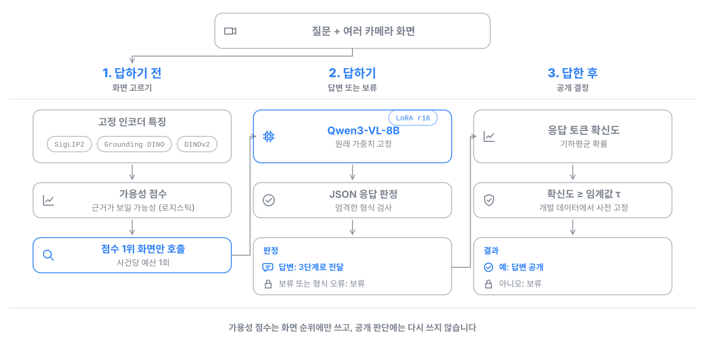
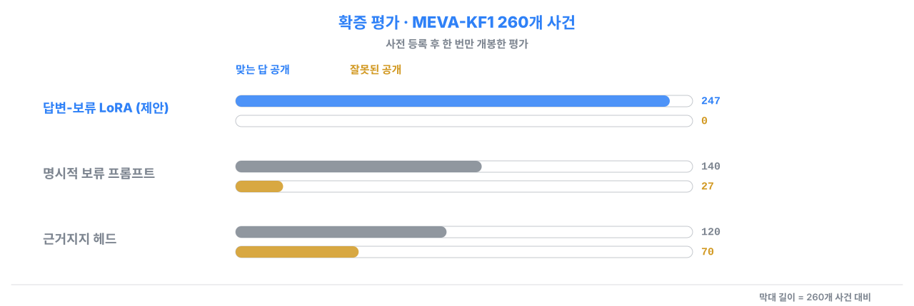
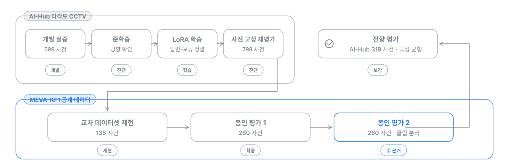

# Multi-View Selective VQA — 근거가 충분할 때만 답하는 다중 시점 영상 질의응답

   
   

> Multi-camera surveillance QA that separates three decisions: which camera view to send to a vision-language model, whether to answer or abstain, and whether to release the answer.
> On a pre-registered, sealed 260-event evaluation (MEVA-KF1), the LoRA answer–abstention policy released 247 correct answers with 0 wrong releases on the selected views, +41.2 pp over an explicit-abstention prompt.

## 한눈에 보기

- **문제**: CCTV 여러 대가 같은 장면을 찍을 때, AI에게 "이 사람이 차 문을 열었나?"를 물으면 화면이 가려져 있어도 그럴듯한 답을 지어냅니다.
- **내가 한 일**: 어느 카메라 화면을 볼지 고르고, 근거가 보이면 답하고 안 보이면 보류하도록 모델을 학습시키고, 확신이 낮은 답은 내보내지 않는 3단계 구조를 설계하고 구현했습니다.
- **검증 방식**: 평가 데이터를 열기 전에 모델, 임계값, 분석 규칙을 해시로 고정하고, 기존 평가와 겹치지 않는 260개 사건으로 한 번만 평가했습니다.
- **결과**: 같은 모델에 "모르면 모른다고 하라"는 프롬프트만 준 경우보다 맞는 답 공개가 **140 → 247건 (+41.2%p)**, 잘못 내보낸 답은 **27 → 0건**
- **논문**: IEEE Access 제1저자 (심사 중)

## 3단계 파이프라인



- 80억 매개변수 VLM(Qwen3-VL-8B)의 원래 가중치는 고정하고 LoRA로 "근거가 보이면 답, 안 보이면 보류"를 학습했습니다.
- 예산 때문에 호출되지 않은 화면은 보류 학습에 쓰지 않아, 화면 선택과 답변 판단이 섞이지 않게 분리했습니다.
- 결과는 미호출, 모델 보류, 임계값 미달 보류, 공개로 단계별로 구분해 기록합니다.

## 주요 결과



| 확인한 것 | 결과 |
|---|---|
| 답변-보류 학습 효과 | 프롬프트 대비 맞는 답 공개 **+41.2%p** (95% CI 35.0–46.9), 사전 기준 3개 모두 충족 |
| 근거 없는 화면에서의 오답 | 근거 없는 후보 화면 836개 중 1개만 공개 |
| 시드 강건성 | 다른 두 시드에서도 +43.5%p, +42.3%p, 세 시드 모두 잘못된 공개 0건 |
| 다른 데이터셋 재현 | MEVA에서 근거 있는 입력 정확도 39.0% → 97.8%, 학습 절차가 재현됨 |
| 화면 선택 | 가용성 점수 247건 vs 의미 유사도 150건 vs 무작위 64.7건 |
| 확신도 공개 게이트 | 정오답 구분 AUROC 0.820, 하위 절반 보류 시 오답률 20.8% → 6.4% |

원본 집계: [`b1_results_report.md`](outputs/b1_open_20260806/b1_results_report.md), [`b1_results.json`](outputs/b1_open_20260806/b1_results.json)

## 검증 방법



개발 데이터로 규칙을 정한 뒤 평가 데이터를 열기 전에 분할, 모델, 프롬프트, 임계값, 분석 규칙을 해시로 고정하고 한 번만 개봉했습니다. 주 근거는 클립과 녹화 구간이 기존 평가와 겹치지 않도록 MILP로 고른 260개 사건의 봉인 평가 2입니다. 통계 판정 방식, 사전 기준 판정 현황, 비용 분석은 [docs/evaluation-details.md](docs/evaluation-details.md)에 정리했습니다.

## 담당 범위

논문 제1저자로 문제 설정, 실험 설계, 구현, 실험 운영, 원고 작성을 직접 수행했습니다.

| 구성요소 | 한 일 | 관련 파일 |
|---|---|---|
| 문제 정식화 | 화면 선택, 답변, 공개를 단계별 역할로 분리하고 가설과 판정 기준 설계 | [`b1_registration.json`](outputs/b1_prereg_20260805/b1_registration.json) |
| 가용성 라벨 감사 | 위치 정보만으로 맞힐 수 있는 지름길 라벨(AUROC 0.998–1.000)을 찾아 폐기하고, 카메라 기하로 "보이는지" 라벨을 새로 생성 | [`w4_metadata_gate.py`](scripts/w4_metadata_gate.py) |
| 화면 선택 | SigLIP2, Grounding DINO, DINOv2 고정 특징과 로지스틱 점수로 근거가 보일 화면 순위화 | [`src/mvevirag/`](src/mvevirag/), [`w4_oneshot_runner.py`](scripts/w4_oneshot_runner.py) |
| 답변-보류 LoRA | 학습 데이터 구성(근거 있음은 정답, 근거 없음은 고정 보류 문구), LoRA 학습, vLLM 평가, 엄격 JSON 판정기 | [`answerer_alignment_lora.py`](scripts/operator/answerer_alignment_lora.py) |
| 사전 등록과 봉인 실행 | MILP 사건 선정, 검정력 시뮬레이션, 해시 고정 등록, 중단 후 재개 가능한 1회 실행 러너 | [`b1_oneshot_runner.py`](scripts/operator/b1_oneshot_runner.py), [`b1_open_analysis.py`](outputs/b1_open_20260806/b1_open_analysis.py) |
| 인프라 | Docker와 vLLM 다중 GPU 추론, 체크포인트 재개, 원시 출력 무결성 검증(13/13 일치) | [`Dockerfile`](Dockerfile) |

## 기술 스택

| 분류 | 사용 기술 |
|---|---|
| 언어와 환경 | Python 3.11, Docker (CUDA 12.4), 다중 GPU 서버 |
| 모델 | Qwen3-VL-8B-Instruct, SigLIP2, Grounding DINO, DINOv2 |
| 학습과 추론 | PyTorch, Hugging Face Transformers, PEFT (LoRA), vLLM |
| 분석 | NumPy, SciPy (MILP, 통계), scikit-learn, OpenCV |
| 재현성 | SHA-256 고정 기록, 사전 등록, 시드 고정, 재개 가능한 체크포인트 |
| 개발 도구 | Claude Code, Codex (AI 코딩 에이전트) |

## 디렉터리 구조

```text
multiview-selective-vqa/
├── src/mvevirag/          # SigLIP2 임베딩, Grounding DINO 탐지 특징
├── scripts/
│   ├── w4_metadata_gate.py        # MEVA 기하 기반 가용성 라벨
│   ├── w4_oneshot_runner.py       # 봉인 평가 1 실행
│   └── operator/                  # LoRA 학습과 평가, 비교군, 봉인 평가 2, 전향 평가
└── outputs/               # 사전 등록 기록과 집계 결과 (표본 단위 산출물 없음)
```

## 실행 방법

실제 실행에는 AI-Hub 원천 데이터(개별 신청), MEVA-KF1, 이 저장소에 없는 중간 산출물(코호트 매니페스트, 특징 파일, LoRA 어댑터)이 필요합니다. 아래는 단계별 진입점입니다.

```bash
git clone https://github.com/NAMUORI00/multiview-selective-vqa.git
cd multiview-selective-vqa
pip install -e ".[gpu,dev]"            # 또는: docker build -t multiview-selective-vqa .
cp .env.example .env

# 1) MEVA 기하 기반 가용성 라벨
python scripts/w4_metadata_gate.py --meva-repo <MEVA_ROOT>

# 2) 답변-보류 LoRA: 데이터 구성 → 학습 → 평가 → 분석
python scripts/operator/answerer_alignment_lora.py build
python scripts/operator/answerer_alignment_lora.py train --epochs 3
python scripts/operator/answerer_alignment_lora.py evaluate --arm tuned --backend vllm
python scripts/operator/answerer_alignment_lora.py analyze --bootstrap 4000

# 3) 봉인 평가 2 등록 분석 (원시 출력 해시 검증 후 집계)
python outputs/b1_open_20260806/b1_open_analysis.py
```

## 데이터

- **AI-Hub 다각도 CCTV 생활안전 데이터**: 라이선스상 재배포할 수 없어 [AI-Hub](https://aihub.or.kr)에서 개별 신청해야 합니다. 영상, 프레임, 라벨은 포함하지 않았습니다.
- **MEVA-KF1**: 공개 데이터셋으로, 공식 배포처에서 내려받아 사용합니다.

## 한계와 다음 단계

- 관심 영역은 주석과 카메라 기하에서 가져온 값(오라클)이고, 사건당 화면 1개만 호출했습니다. 잘못된 공개 0건은 이 표본에서의 결과입니다.
- 다음 단계로 탐지기 기반 관심 영역으로 전체 파이프라인을 검증하고, 여러 화면 호출과 응답 융합, 온라인 환경의 지연과 비용 실측을 진행합니다.

## 논문

김유석 외, *Role-Separated Selective Response for Question Answering in Multi-View Video Surveillance*, IEEE Access (심사 중). 원고는 게재 확정 후 공개합니다.

관제 보조용 의사결정 지원 연구이며, 공개된 답도 사람의 확인이 필요합니다. 라이선스는 따로 정하지 않았습니다(열람 목적 공개).
