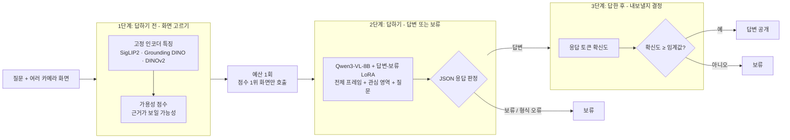
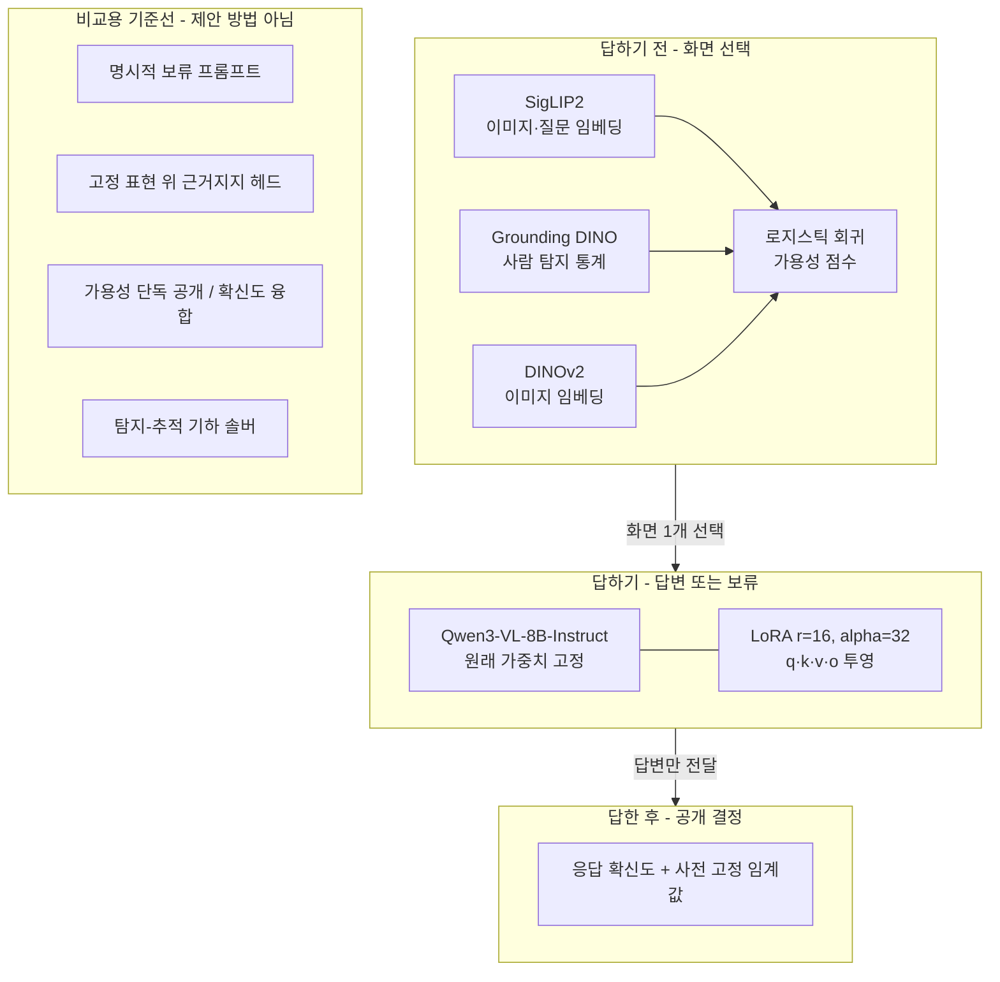
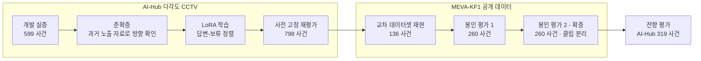

# Multi-View Selective VQA — 근거가 충분할 때만 답하는 다중 시점 영상 질의응답

(내부 프로젝트명: MV-EviRAG)

   
   -00629B)

> Multi-camera surveillance QA that separates three decisions: which camera view to send to a vision-language model, whether to answer or abstain, and whether to release the answer.
> On a pre-registered, sealed 260-event evaluation (MEVA-KF1), the LoRA answer–abstention policy released 247 correct answers with 0 wrong releases on the selected views, +41.2 pp over an explicit-abstention prompt.
> Bounded by oracle regions of interest, one invoked view per event, and rule-defined (not human-judged) evidence availability.

> [!NOTE]
> 비공개 연구 저장소에서 **코드와 집계 결과만 골라 정리한 공개 쇼케이스**입니다.
> 원천 영상·프레임·라벨, 표본 단위 산출물, 모델 가중치, 원고는 포함하지 않습니다.

## 한눈에 보기

- **문제**: CCTV 여러 대가 같은 장면을 찍을 때, AI에게 "이 사람이 차 문을 열었나?"를 물으면 화면이 가려져 있어도 그럴듯한 답을 지어냄
- **내가 한 일**: ① 어느 카메라 화면을 볼지 고르고 ② 근거가 보이면 답하고 안 보이면 보류하도록 모델을 학습시키고 ③ 확신이 낮은 답은 내보내지 않는 3단계 구조를 설계·구현
- **검증 방식**: 평가 데이터를 열기 전에 모델·임계값·분석 규칙을 해시로 고정하고, 기존 평가와 클립·녹화구간이 겹치지 않는 260개 사건으로 한 번만 평가
- **결과**: 같은 모델에 "모르면 모른다고 하라"고 프롬프트만 준 경우보다 맞는 답 공개가 **140 → 247건 (+41.2%p)**, 잘못 내보낸 답은 **27 → 0건**
- **산출물**: IEEE Access 투고 논문 제1저자 (2026.08 투고, 심사 중)

## 쉽게 설명하면

**다중 시점 CCTV 질의응답**
- 한 장소를 여러 각도의 카메라가 동시에 찍고, 관제 요원이 자연어로 질문하면 AI(비전-언어 모델, VLM)가 화면을 보고 답하는 작업
- 모든 화면을 AI에 넣으면 GPU 비용이 커지므로, 정해진 호출 횟수(예산) 안에서 **어떤 화면을 보낼지** 먼저 골라야 함

**"근거가 부족하면 답하지 않고 보류"**
- 사람이 화면에 크게 잡혀도 기둥에 손이 가려졌다면 "휴대폰을 들고 있나?"에 답할 근거가 없음
- 이럴 때 추측하지 않고 "이 화면으로는 판단 불가"라고 **보류**하는 것이 목표. 관제 보조에서는 틀린 답이 보류보다 위험함

**LoRA**
- 큰 모델(Qwen3-VL-8B)의 원래 가중치는 그대로 두고, 작은 보조 행렬만 추가로 학습하는 경량 미세조정 방법
- 이 프로젝트에서는 "근거가 보이면 답, 안 보이면 보류"라는 행동을 LoRA로 학습

## 나의 기여

논문 제1저자로 **문제 설정 → 실험 설계 → 구현 → 실험 운영 → 원고 작성**을 직접 수행. 공동 저자는 지도·검토를 맡음.

| 구성요소 | 내가 한 일 | 결과 | 관련 파일 |
|---|---|---|---|
| 문제 정식화 | 화면 선택·답변·공개를 시점별 역할로 분리. 가설(H1/H2)·판정 기준·비주장 범위 설계 | 이후 모든 실험의 사전 등록 기준 | [`b1_registration.json`](outputs/b1_prereg_20260805/b1_registration.json) |
| 가용성 라벨 구성·감사 | 기존 대리 라벨이 위치 정보만으로 맞힐 수 있는 지름길(AUROC 0.998–1.000)임을 찾아 폐기. MEVA는 카메라 모델(KRTD) 기하로 "보이는지/안 보이는지" 라벨 생성 | 지름길 없는 평가 라벨 확보 | [`scripts/w4_metadata_gate.py`](scripts/w4_metadata_gate.py) |
| 화면 선택(가용성 점수) | SigLIP2·Grounding DINO·DINOv2 고정 특징 + 로지스틱 점수로 "근거가 보일 화면" 순위화. 무작위·의미 유사도·과제 맞춤 선택기와 비교 | 의미 유사도·무작위보다 많은 정답 공개, 과제 맞춤 선택기와 동률 | [`src/mvevirag/`](src/mvevirag/), [`scripts/w4_oneshot_runner.py`](scripts/w4_oneshot_runner.py) |
| 답변-보류 LoRA | Qwen3-VL-8B 학습 데이터 구성(근거 있음→정답, 근거 없음→고정 보류 문구, 같은 범주 hard negative), LoRA 학습, vLLM 평가, 엄격 JSON 판정기 | 확증 평가에서 맞는 답 공개 247/260, 잘못된 공개 0 | [`answerer_alignment_lora.py`](scripts/operator/answerer_alignment_lora.py), [`w5a_fair_baselines_runner.py`](scripts/operator/w5a_fair_baselines_runner.py) |
| 확신도 기반 공개 | 응답 토큰 기하평균 확률로 확신도 산출, 개발 데이터에서 임계값 τ 사전 선택 | 전향 평가에서 하위 절반 보류 시 오답률 20.8% → 6.4% | 위 스크립트, [`secondary_generalization_bc.py`](scripts/operator/secondary_generalization_bc.py) |
| 사전 등록·봉인 실행 | MILP로 기존 평가와 클립·녹화구간이 겹치지 않는 260사건 선정, 검정력 시뮬레이션, 해시 고정 등록, 체크포인트 재개형 1회 실행 러너 | 동일 시드 2회 실행 시 매니페스트 해시 일치 | [`b1_clip_slot_cohort.py`](scripts/operator/b1_clip_slot_cohort.py), [`b1_oneshot_runner.py`](scripts/operator/b1_oneshot_runner.py), [`power_sim.py`](outputs/b1_prereg_pins_20260805/power_sim.py) |
| 통계 분석 | 사건 단위 부트스트랩 4,000회, 3조건 동시 충족 판정, 클립·사이트 군집 민감도 | H1·H2 사전 기준 모두 충족 | [`b1_open_analysis.py`](outputs/b1_open_20260806/b1_open_analysis.py), [`b1_results_report.md`](outputs/b1_open_20260806/b1_results_report.md) |
| 전향 평가·강한 기준선 | "항상 yes"나 crop 위치로는 풀 수 없는 극성 균형 2×2 평가 구성, 탐지-추적 기하 솔버 기준선 추가 | 네 칸 모두 맞힌 사건 63.3% (솔버 38.6%) | [`postreview_2x2_campaign.py`](scripts/operator/postreview_2x2_campaign.py), [`postreview_detector_solver_20260819.py`](scripts/operator/postreview_detector_solver_20260819.py) |
| 인프라 | Docker/vLLM 다중 GPU 추론, 중단 후 재개 가능한 체크포인트, 원격 GPU 서버 전송·정리 | 중단·재개를 거쳐 봉인 실행 완료, 원시 출력 무결성 13/13 일치 | [`Dockerfile`](Dockerfile), 러너 전반 |

**개발 기록·도구** (비공개 원본 저장소, 2026-06-19 ~ 2026-10-07)
- 218 커밋 중 216건 본인 계정, 2건은 본인이 운용한 코딩 에이전트의 자동 커밋. 누적 추가 라인 `src/` 약 27k, `scripts/` 약 16.5k, `tests/` 약 7k (이후 정리 중 상당 부분 통합·삭제)
- Claude Code, Codex CLI를 페어 프로그래밍 도구로 사용 (다수 커밋에 Co-Authored-By 표기). 연구 질문·실험 설계·판정 기준·결과 해석·최종 검증은 본인 담당
- 에이전트 작업 규칙(사전 동결, 봉인 데이터 접근 제한, 수치-산출물 대조)을 직접 설계해 운영

## 시스템 구조

### 3단계 파이프라인



- 가용성 점수는 **화면 순위에만** 사용, 답 공개 판단에는 재사용하지 않음. 임계값 τ는 개발 데이터에서 미리 고정 (주 시드 τ ≈ 0.981)
- 결과를 단계별로 구분해 기록: 미호출 / 모델 보류 / 임계값 미달 보류 / 공개

### 역할 분리: 어떤 모델이 무엇을 하나



- 학습 핵심: 같은 데이터에서 **근거 있는 입력엔 정답**, **근거 없는 입력엔 고정 보류 문구**를 목표로 줌
- 예산 때문에 호출되지 않은 화면은 보류 학습에 쓰지 않음 → 화면 선택 결정과 답변자 판단이 섞이지 않게 분리

## 주요 결과

**확증 평가** — MEVA-KF1 공개 데이터, 기존 평가와 겹치지 않는 260개 사건, 사전 지정 주 시드

| 방법 | 맞는 답 공개 | 잘못된 공개 | 공개 수율 |
|---|---:|---:|---:|
| **답변-보류 LoRA (제안)** | **247** | **0** | **95.0%** |
| 명시적 보류 프롬프트 (H1 비교) | 140 | 27 | 53.8% |
| 고정 표현 근거지지 헤드 (H2 비교) | 120 | 70 | 46.2% |

- 공개 수율 = 맞는 답 공개 수 / 260 · 원본: [`b1_results_report.md`](outputs/b1_open_20260806/b1_results_report.md), [`b1_results.json`](outputs/b1_open_20260806/b1_results.json)

| 확인한 것 | 결과 | 조건 |
|---|---|---|
| 답변-보류 학습 효과 | 프롬프트 대비 맞는 답 공개 **+41.2%p** (95% CI 35.0–46.9) | 사전 기준 3개 모두 충족 |
| 근거 없는 화면에서의 오답 | 근거 없는 836개 후보 화면 중 1개만 공개 | 전체 후보 감사 |
| 시드 강건성 | 다른 두 시드에서 +43.5%p, +42.3%p, 세 시드 모두 잘못된 공개 0 | 보조 분석 |
| 이전 봉인 평가 (코호트 1) | 같은 방향: 245 vs 162, 근거 없는 화면 공개 0/796 | [`w4_results.json`](outputs/meva_full_20260713/w4_oneshot_20260714/w4_results.json) |
| 다른 데이터셋으로 재현 | MEVA 근거 있는 입력 정확도 39.0% → 97.8% | 어댑터가 아닌 **학습 절차**가 재현됨 |
| 극성 균형 전향 평가 (AI-Hub 319 사건) | 네 칸 매크로 정확도 +43.6%p, 네 칸 모두 맞힌 사건 63.3% | 상수 응답 상한 50.0%, 솔버 38.6% |
| 화면 선택 | 가용성 247 vs 의미 유사도 150 vs 무작위 64.7 (기댓값) | 과제 맞춤 선택기와는 동률 247 |
| 확신도 공개 게이트 | 정오답 구분 AUROC 0.820, 하위 절반 보류 시 오답률 20.8% → 6.4% | 전향 평가 기준 |

- 잘못된 공개 0건은 **이 표본에서의 결과**이며 일반적인 안전 보장이 아님. 관심 영역은 주석·카메라 기하에서 가져온 값(오라클), 사건당 화면 1개만 호출
- 일부 수치(교차 데이터셋, 전향 평가, 화면 선택 절제)는 투고 원고 기준이며, 이 저장소에는 해당 집계 파일 일부만 포함

## 검증 방법

개발 데이터로 규칙을 정한 뒤, 평가 데이터를 열기 전에 **분할·모델·프롬프트·임계값·분석 규칙을 해시로 고정**하고 한 번만 개봉.



| 단계 | 하는 일 | 근거 강도 |
|---|---|---|
| 개발 실증 → 준확증 | 구성요소 분해, 과거 분석에 노출된 자료로 방향만 확인 | 개발·진단 |
| LoRA 학습 → 사전 고정 재평가 | 내부 고정 규칙으로 노출 자료 재평가 | 진단 (독립 확증 아님) |
| 교차 데이터셋 재현 | 다른 데이터셋에서 학습 절차 재현 여부 확인 | 재현 |
| 봉인 평가 1·2 | 사전 등록 가설·기준으로 1회 개봉 | **확증** (평가 2가 주 근거) |
| 전향 평가 | 지름길로 풀 수 없게 설계한 별도 검증 | 보강 (확증 아님) |

## 엔지니어용 상세

### 통계 판정 방식

- **사건 단위 부트스트랩**: 260개 사건을 복원 추출로 4,000번 다시 뽑아 차이의 분포를 구함 → 95% 신뢰구간(CI)
- **3조건 동시 충족(IUT)**: 아래 셋을 모두 만족해야 가설 통과
  1. 맞는 답 공개 수율 차이의 95% CI 하한 > 0
  2. 선택 화면 잘못된 공개 위험 차이의 단측 95% 상한 ≤ +5%p
  3. 근거 없는 화면 공개(사건 단위) 위험 차이의 단측 95% 상한 ≤ +5%p
- **비열등성**: "더 나쁘지 않다"를 보이는 검정. 위 2·3번처럼 허용 마진(+5%p) 안에 있는지 확인
- **McNemar / Newcombe**: 같은 사건 쌍에서 두 방법의 맞음·틀림이 갈린 경우만 비교하는 검정과 그 신뢰구간. 보조 기술 통계로만 사용
- **Holm 보정**: 여러 비교를 동시에 할 때 우연히 유의해지는 것을 막는 p값 보정. 보조 비교군 4개에 적용
- **군집 민감도**: 같은 클립(63개)·사이트(3개) 단위로 묶어 재추출해도 방향 유지 확인 (사이트는 3개뿐이라 기술용)
- **검정력**: N=260에서 10%p 차이 검출 검정력 약 0.80 (사전 시뮬레이션, [`b1_freeze_summary.md`](outputs/b1_prereg_20260805/b1_freeze_summary.md))

### 사전 기준 판정 현황

| 항목 | 판정 | 비고 |
|---|---|---|
| H1: 답변-보류 LoRA vs 명시적 보류 프롬프트 (봉인 평가 2) | 충족 | 3조건 모두 통과 |
| H2: 답변-보류 LoRA vs 근거지지 헤드 (봉인 평가 2) | 충족 | 3조건 모두 통과 |
| 화면 선택 우월성: 가용성 vs 과제 맞춤 선택기 (봉인 평가 1) | 미충족 | 차이 0.0%p, 사전 기준 +10%p. 확증 평가 절제도 동률 247 vs 247 |
| 노출 자료 재평가 행동 한계 2종 | 미충족 | 근거 있는 입력 정확도 4.2% → 52.1%, 독립 확증으로 해석하지 않음 |
| 라우팅 안전 비열등성 마진 (노출 자료) | 미충족 | 확신도·가용성 사후 융합은 추가 효용 없어 기각 |
| 전향 평가 행 단위 McNemar | 편차 기록 | 상관된 4행을 독립으로 취급하는 설계 오류 → 해석에서 제외, "보강"으로 분류 |

### 비용

- 확증 평가 총 GPU 시간(CUDA 타이머): 가용성 선택 약 104초 vs 과제 맞춤 선택기 약 246초, 정답 공개는 둘 다 247건
- 그 외 비용·지연 수치는 저장된 응답을 정책별로 재생한 오프라인 분석. AI-Hub 50% 예산의 764/798은 정답 수가 아니라 **가용 쌍 회수 수**

## 기술 스택

| 분류 | 사용 기술 |
|---|---|
| 언어·환경 | Python 3.11, Docker (CUDA 12.4), 다중 GPU 서버 |
| 모델 | Qwen3-VL-8B-Instruct (답변자), SigLIP2, Grounding DINO, DINOv2 (고정 인코더) |
| 학습·추론 | PyTorch, Hugging Face Transformers, PEFT (LoRA), vLLM (LoRA 서빙, 토큰 logprob) |
| 분석 | NumPy, SciPy (MILP, 통계), scikit-learn (로지스틱 점수기), OpenCV |
| 재현성 | SHA-256 고정 기록, 사전 등록, 시드 고정, 결정적 정렬, 원자적 쓰기·재개 체크포인트 |

## 디렉터리 구조

```text
multiview-selective-vqa/
├── src/mvevirag/
│   ├── embedding/siglip2.py           # SigLIP2 이미지·질문 임베딩
│   └── detection/grounding_dino.py    # Grounding DINO 탐지 요약 특징
├── scripts/
│   ├── w4_metadata_gate.py            # MEVA 기하 기반 가용성 라벨·코호트 게이트
│   ├── w4_oneshot_runner.py           # 봉인 평가 1: 특징·가용성 점수·라우팅·재생
│   └── operator/
│       ├── answerer_alignment_lora.py # 답변-보류 LoRA 데이터 구성·학습·평가
│       ├── w5a_fair_baselines_runner.py  # 동일 조건 비교군 (프롬프트·헤드·SFT)
│       ├── secondary_generalization_bc.py # AI-Hub 재평가: 선택기·라우팅·공개 게이트
│       ├── b1_clip_slot_cohort.py     # 봉인 평가 2: MILP 클립 분리 선정
│       ├── b1_oneshot_runner.py       # 봉인 평가 2: 실행·원시 출력 봉인
│       ├── postreview_2x2_campaign.py # 극성 균형 전향 평가
│       └── postreview_detector_solver_20260819.py  # 탐지-추적 기준선
└── outputs/                           # 집계 기록만 (표본 단위 산출물 없음)
    ├── b1_prereg_20260805/            # 봉인 평가 2 사전 등록·임계값
    ├── b1_prereg_pins_20260805/       # 검정력 시뮬레이션
    ├── b1_open_20260806/              # 등록 분석 코드·집계 결과·보고서
    ├── meva_full_20260713/w4_oneshot_20260714/  # 봉인 평가 1 집계
    ├── postreview_acceptance_20260814/ # 전향 평가 고정 프로토콜
    └── postreview_detector_solver_20260819/    # 솔버 고정 설정·test 집계
```

## 실행 방법

> [!IMPORTANT]
> 각 단계의 **진입점**만 정리. 실제 실행에는 AI-Hub 원천 데이터(개별 신청), MEVA-KF1, 이 저장소에 없는 고정 중간 산출물(코호트 매니페스트, 특징 파일, LoRA 어댑터)이 필요함.
> 공개용으로 절대 경로·호스트 이름을 치환해, 일부 고정 기록의 SHA-256 값은 원본 파일 기준.

```bash
# 0) 환경
git clone https://github.com/NAMUORI00/multiview-selective-vqa.git
cd multiview-selective-vqa
pip install -e ".[gpu,dev]"            # 또는: docker build -t multiview-selective-vqa .
cp .env.example .env                   # 로컬 경로 등만 기입 (.env는 커밋 금지)

# 1) MEVA 기하 기반 가용성 라벨·코호트 게이트 (메타데이터만 읽음)
python scripts/w4_metadata_gate.py --meva-repo <MEVA_ROOT>

# 2) 답변-보류 LoRA: 데이터 구성 → 학습 → 평가 → 분석
python scripts/operator/answerer_alignment_lora.py build
python scripts/operator/answerer_alignment_lora.py train --epochs 3
python scripts/operator/answerer_alignment_lora.py evaluate --arm tuned --backend vllm
python scripts/operator/answerer_alignment_lora.py analyze --bootstrap 4000

# 3) 봉인 평가 1: 사전 점검 후 단계별 실행 (dry-run은 모델·영상을 열지 않음)
python scripts/w4_oneshot_runner.py dry-run
python scripts/w4_oneshot_runner.py {preflight|materialize|features|answerer|replay|seal} ...

# 4) 봉인 평가 2: 등록 분석 (원시 출력 해시 검증 후 집계)
python outputs/b1_open_20260806/b1_open_analysis.py

# 5) 탐지-추적 기준선
python scripts/operator/postreview_detector_solver_20260819.py --extract --partition test
python scripts/operator/postreview_detector_solver_20260819.py --fit
python scripts/operator/postreview_detector_solver_20260819.py --apply --partition test
```

## 데이터
- **AI-Hub 다각도 CCTV 생활안전 데이터 (v1.0 Beta)**: 라이선스상 재배포 불가. [AI-Hub](https://aihub.or.kr)에서 개별 신청 필요. 영상·프레임·라벨·표본 단위 파생 자료 미포함
- **MEVA-KF1**: 공개 데이터셋. MEVA 공식 배포처에서 내려받아 사용

## 다음 작업

- [ ] 화면 선택: 과제 맞춤 선택기 대비 +10%p 우월성 기준을 넘는 가용성 점수 개선 (현재 동률)
- [ ] 라우팅 안전 비열등성 마진을 충족하는 공개 규칙 재설계 및 새 자료로 재검증
- [ ] 오프라인 재생이 아닌 온라인 배치 환경에서 지연·처리량·비용 실측
- [ ] 전향 평가를 사건 단위 검정으로 재설계해 확증 평가로 재실시
- [ ] 오라클 관심 영역 대신 탐지기 기반 관심 영역으로 전체 파이프라인 검증
- [ ] 사건당 여러 화면 호출(B>1)과 응답 융합 규칙 설계
- [ ] 규칙 기반 가용성 라벨을 사람 판정 충분성 라벨로 보강
- [ ] 다른 VLM·데이터셋으로 일반화 확인 (현재 Qwen3-VL-8B, AI-Hub, MEVA-KF1)
- [ ] 전체 코드·고정 기록 공개 (논문 게재 후, 데이터 가용성 진술에 따름)

## 논문

- 김유석 외, *Role-Separated Selective Response for Question Answering in Multi-View Video Surveillance*, IEEE Access (2026.08 투고, **심사 중**, 원고는 게재 확정 전까지 비공개)

라이선스: 별도 라이선스 없음 (열람 목적 공개)

---

<sub>Contact: GitHub [@NAMUORI00](https://github.com/NAMUORI00) · 수치는 고정 산출물과 투고 원고 기준이며, 심사 과정에서 원고 표현은 바뀔 수 있음. 관제 보조용 의사결정 지원 연구이며, 공개된 답도 사람의 확인이 필요함.</sub>
