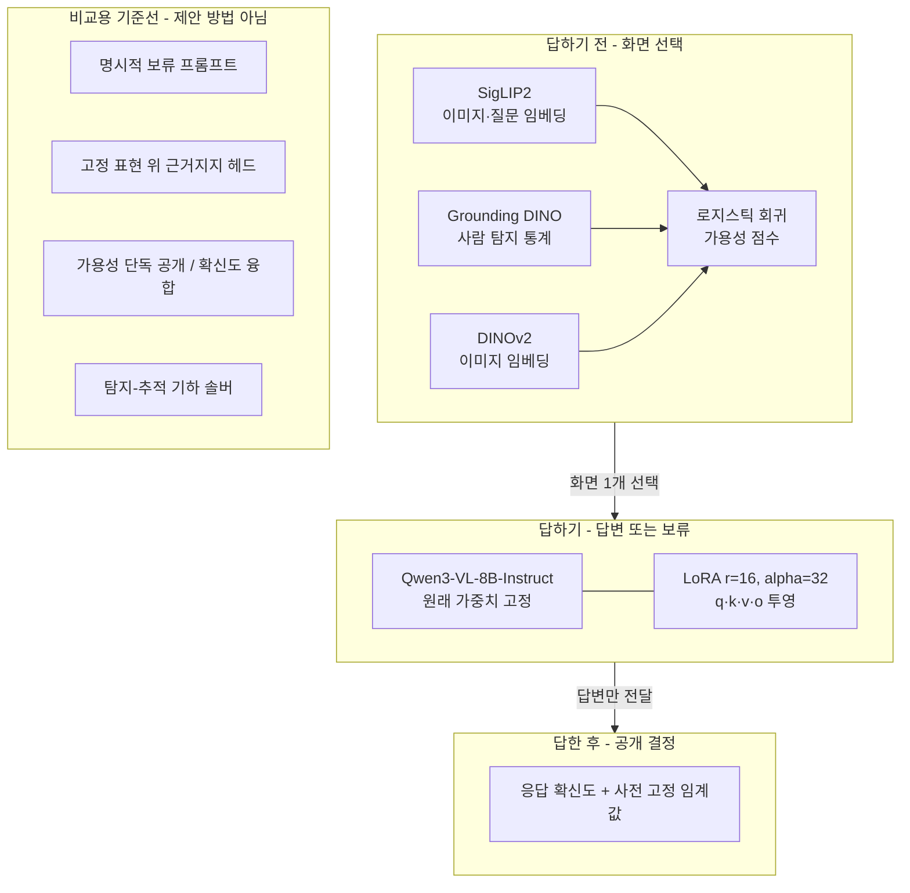
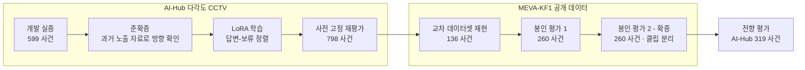

# 평가 상세

[README로 돌아가기](../README.md)

README의 결과와 검증 절차를 판정 기준, 통계 방법, 사전 기준 판정 현황까지 포함해 정리한 문서입니다.

## 용어 설명

**다중 시점 CCTV 질의응답**
- 한 장소를 여러 각도의 카메라가 동시에 찍고, 관제 요원이 자연어로 질문하면 AI(비전-언어 모델, VLM)가 화면을 보고 답하는 작업
- 모든 화면을 AI에 넣으면 GPU 비용이 커지므로, 정해진 호출 횟수(예산) 안에서 **어떤 화면을 보낼지** 먼저 골라야 함

**"근거가 부족하면 답하지 않고 보류"**
- 사람이 화면에 크게 잡혀도 기둥에 손이 가려졌다면 "휴대폰을 들고 있나?"에 답할 근거가 없음
- 이럴 때 추측하지 않고 "이 화면으로는 판단 불가"라고 **보류**하는 것이 목표. 관제 보조에서는 틀린 답이 보류보다 위험함

**LoRA**
- 큰 모델(Qwen3-VL-8B)의 원래 가중치는 그대로 두고, 작은 보조 행렬만 추가로 학습하는 경량 미세조정 방법
- 이 프로젝트에서는 "근거가 보이면 답, 안 보이면 보류"라는 행동을 LoRA로 학습

## 모델별 역할

- 학습 핵심: 같은 데이터에서 **근거 있는 입력엔 정답**, **근거 없는 입력엔 고정 보류 문구**를 목표로 줌
- 예산 때문에 호출되지 않은 화면은 보류 학습에 쓰지 않음 → 화면 선택 결정과 답변자 판단이 섞이지 않게 분리

## 결과 전체

**확증 평가** — MEVA-KF1 공개 데이터, 기존 평가와 겹치지 않는 260개 사건, 사전 지정 주 시드

| 방법 | 맞는 답 공개 | 잘못된 공개 | 공개 수율 |
|---|---:|---:|---:|
| **답변-보류 LoRA (제안)** | **247** | **0** | **95.0%** |
| 명시적 보류 프롬프트 (H1 비교) | 140 | 27 | 53.8% |
| 고정 표현 근거지지 헤드 (H2 비교) | 120 | 70 | 46.2% |

- 공개 수율 = 맞는 답 공개 수 / 260 · 원본: [`b1_results_report.md`](../outputs/b1_open_20260806/b1_results_report.md), [`b1_results.json`](../outputs/b1_open_20260806/b1_results.json)

| 확인한 것 | 결과 | 조건 |
|---|---|---|
| 답변-보류 학습 효과 | 프롬프트 대비 맞는 답 공개 **+41.2%p** (95% CI 35.0–46.9) | 사전 기준 3개 모두 충족 |
| 근거 없는 화면에서의 오답 | 근거 없는 836개 후보 화면 중 1개만 공개 | 전체 후보 감사 |
| 시드 강건성 | 다른 두 시드에서 +43.5%p, +42.3%p, 세 시드 모두 잘못된 공개 0 | 보조 분석 |
| 이전 봉인 평가 (코호트 1) | 같은 방향: 245 vs 162, 근거 없는 화면 공개 0/796 | [`w4_results.json`](../outputs/meva_full_20260713/w4_oneshot_20260714/w4_results.json) |
| 다른 데이터셋으로 재현 | MEVA 근거 있는 입력 정확도 39.0% → 97.8% | 어댑터가 아닌 **학습 절차**가 재현됨 |
| 극성 균형 전향 평가 (AI-Hub 319 사건) | 네 칸 매크로 정확도 +43.6%p, 네 칸 모두 맞힌 사건 63.3% | 상수 응답 상한 50.0%, 솔버 38.6% |
| 화면 선택 | 가용성 247 vs 의미 유사도 150 vs 무작위 64.7 (기댓값) | 과제 맞춤 선택기와는 동률 247 |
| 확신도 공개 게이트 | 정오답 구분 AUROC 0.820, 하위 절반 보류 시 오답률 20.8% → 6.4% | 전향 평가 기준 |

- 잘못된 공개 0건은 **이 표본에서의 결과**이며 일반적인 안전 보장이 아님. 관심 영역은 주석·카메라 기하에서 가져온 값(오라클), 사건당 화면 1개만 호출
- 일부 수치(교차 데이터셋, 전향 평가, 화면 선택 절제)는 투고 원고 기준이며, 이 저장소에는 해당 집계 파일 일부만 포함

## 검증 단계와 근거 강도

개발 데이터로 규칙을 정한 뒤, 평가 데이터를 열기 전에 **분할·모델·프롬프트·임계값·분석 규칙을 해시로 고정**하고 한 번만 개봉.

| 단계 | 하는 일 | 근거 강도 |
|---|---|---|
| 개발 실증 → 준확증 | 구성요소 분해, 과거 분석에 노출된 자료로 방향만 확인 | 개발·진단 |
| LoRA 학습 → 사전 고정 재평가 | 내부 고정 규칙으로 노출 자료 재평가 | 진단 (독립 확증 아님) |
| 교차 데이터셋 재현 | 다른 데이터셋에서 학습 절차 재현 여부 확인 | 재현 |
| 봉인 평가 1·2 | 사전 등록 가설·기준으로 1회 개봉 | **확증** (평가 2가 주 근거) |
| 전향 평가 | 지름길로 풀 수 없게 설계한 별도 검증 | 보강 (확증 아님) |

## 통계와 비용

### 통계 판정 방식

- **사건 단위 부트스트랩**: 260개 사건을 복원 추출로 4,000번 다시 뽑아 차이의 분포를 구함 → 95% 신뢰구간(CI)
- **3조건 동시 충족(IUT)**: 아래 셋을 모두 만족해야 가설 통과
  1. 맞는 답 공개 수율 차이의 95% CI 하한 > 0
  2. 선택 화면 잘못된 공개 위험 차이의 단측 95% 상한 ≤ +5%p
  3. 근거 없는 화면 공개(사건 단위) 위험 차이의 단측 95% 상한 ≤ +5%p
- **비열등성**: "더 나쁘지 않다"를 보이는 검정. 위 2·3번처럼 허용 마진(+5%p) 안에 있는지 확인
- **McNemar / Newcombe**: 같은 사건 쌍에서 두 방법의 맞음·틀림이 갈린 경우만 비교하는 검정과 그 신뢰구간. 보조 기술 통계로만 사용
- **Holm 보정**: 여러 비교를 동시에 할 때 우연히 유의해지는 것을 막는 p값 보정. 보조 비교군 4개에 적용
- **군집 민감도**: 같은 클립(63개)·사이트(3개) 단위로 묶어 재추출해도 방향 유지 확인 (사이트는 3개뿐이라 기술용)
- **검정력**: N=260에서 10%p 차이 검출 검정력 약 0.80 (사전 시뮬레이션, [`b1_freeze_summary.md`](../outputs/b1_prereg_20260805/b1_freeze_summary.md))

### 사전 기준 판정 현황

| 항목 | 판정 | 비고 |
|---|---|---|
| H1: 답변-보류 LoRA vs 명시적 보류 프롬프트 (봉인 평가 2) | 충족 | 3조건 모두 통과 |
| H2: 답변-보류 LoRA vs 근거지지 헤드 (봉인 평가 2) | 충족 | 3조건 모두 통과 |
| 화면 선택 우월성: 가용성 vs 과제 맞춤 선택기 (봉인 평가 1) | 미충족 | 차이 0.0%p, 사전 기준 +10%p. 확증 평가 절제도 동률 247 vs 247 |
| 노출 자료 재평가 행동 한계 2종 | 미충족 | 근거 있는 입력 정확도 4.2% → 52.1%, 독립 확증으로 해석하지 않음 |
| 라우팅 안전 비열등성 마진 (노출 자료) | 미충족 | 확신도·가용성 사후 융합은 추가 효용 없어 기각 |
| 전향 평가 행 단위 McNemar | 편차 기록 | 상관된 4행을 독립으로 취급하는 설계 오류 → 해석에서 제외, "보강"으로 분류 |

### 비용

- 확증 평가 총 GPU 시간(CUDA 타이머): 가용성 선택 약 104초 vs 과제 맞춤 선택기 약 246초, 정답 공개는 둘 다 247건
- 그 외 비용·지연 수치는 저장된 응답을 정책별로 재생한 오프라인 분석. AI-Hub 50% 예산의 764/798은 정답 수가 아니라 **가용 쌍 회수 수**

## 후속 과제 전체

- [ ] 화면 선택: 과제 맞춤 선택기 대비 +10%p 우월성 기준을 넘는 가용성 점수 개선 (현재 동률)
- [ ] 라우팅 안전 비열등성 마진을 충족하는 공개 규칙 재설계 및 새 자료로 재검증
- [ ] 오프라인 재생이 아닌 온라인 배치 환경에서 지연·처리량·비용 실측
- [ ] 전향 평가를 사건 단위 검정으로 재설계해 확증 평가로 재실시
- [ ] 오라클 관심 영역 대신 탐지기 기반 관심 영역으로 전체 파이프라인 검증
- [ ] 사건당 여러 화면 호출(B>1)과 응답 융합 규칙 설계
- [ ] 규칙 기반 가용성 라벨을 사람 판정 충분성 라벨로 보강
- [ ] 다른 VLM·데이터셋으로 일반화 확인 (현재 Qwen3-VL-8B, AI-Hub, MEVA-KF1)
- [ ] 전체 코드·고정 기록 공개 (논문 게재 후, 데이터 가용성 진술에 따름)
